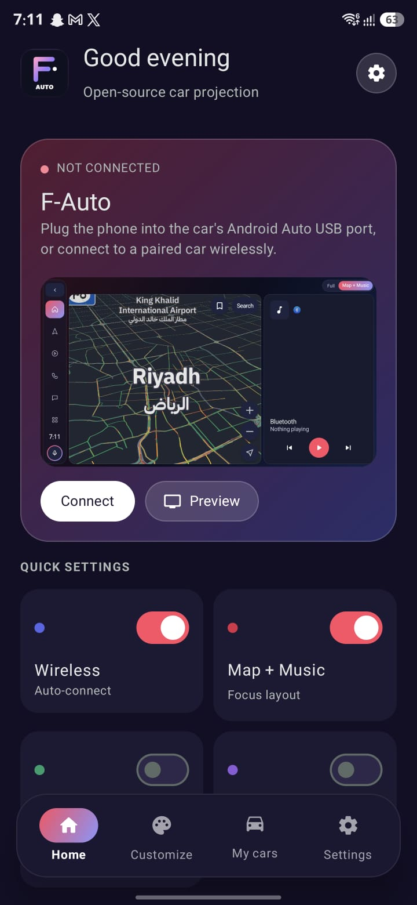
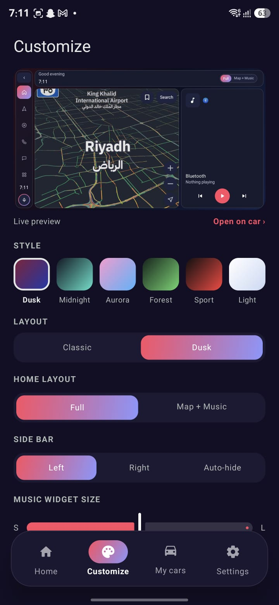
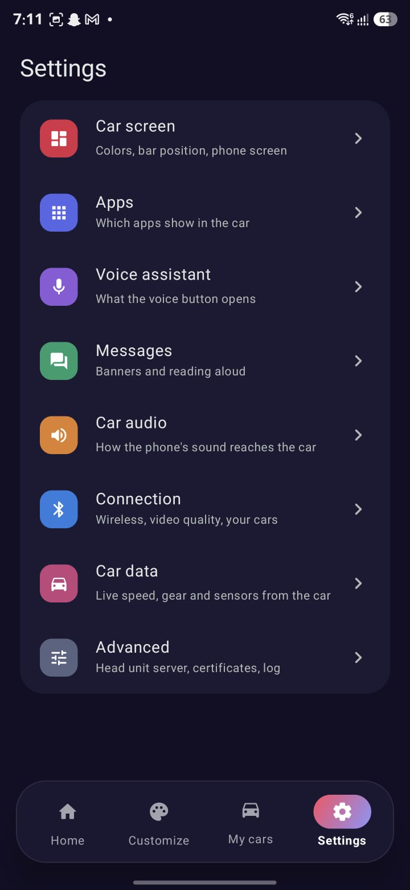
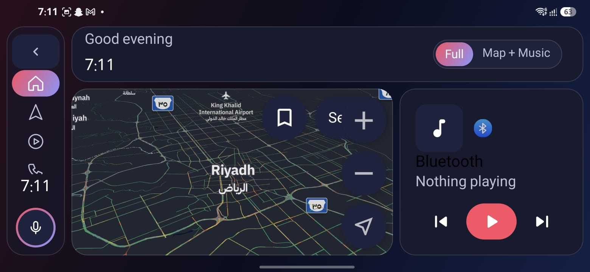
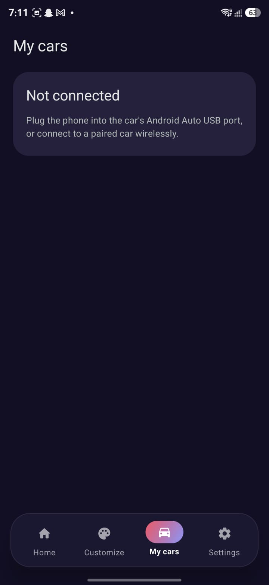

# F-Auto

F-Auto is an Android app that hosts Android Auto's own protocol on your phone and draws its own
car screen — no Google Play Services, no official Android Auto app required. It connects to your
car's head unit over USB or wirelessly (Bluetooth + Wi-Fi, including aftermarket wireless
dongles), and runs navigation, media, messaging, calling and other apps on the car's display.

> [!WARNING]
> This is a personal project, tuned and tested on one specific car and wireless adapter. It is
> early software — don't depend on it while driving until you've tried it thoroughly in your own
> setup, parked, first.

## Features

- **Projection over USB or wireless** — Bluetooth RFCOMM pairing, Wi-Fi join, then a TCP session
  to the car's head unit, the same way Android Auto itself connects.
- **Wireless adapter compatibility mode** — most wireless Android Auto dongles work out of the
  box; a few cheaper/aftermarket ones need message order that exactly matches a genuine phone.
  Auto/On/Off setting in Connection settings; Auto guesses from the adapter's Bluetooth name.
- **Automatic reconnect** — if the wireless dongle drops mid-drive, F-Auto retries the connection
  on its own (up to 5 times) while it's still Bluetooth-bonded, instead of needing a manual
  relaunch.
- **Two selectable UI layouts, independent of color theme:**
  - **Classic** — a fixed icon rail and a persistent bottom media/status bar around a dashboard
    that toggles between a full widget view and a map+music view.
  - **Dusk** — built for 8" (≈17.5×10.5 cm) head units: a floating, collapsible glass rail: hide
    it with one tap to give the map or media more width, and bring it back with the edge handle.
    Home has a Full / Map+Music toggle with a "continue playing" pill; Phone shows favorite
    contacts and recent calls at a glance; Settings uses a category sidebar instead of one long
    list.
- **Six color themes** — Midnight, Aurora, Forest, Light, Sport, Dusk — mixable with either
  layout, so there are 12 total looks.
- **Navigation** — any app built with the AndroidX Car App Library (Google Maps is excluded by
  Google's own host verification, not by F-Auto — see [Limitations](#limitations)).
- **Media** — any app with a media3 or `MediaBrowserService` library: streaming services,
  podcasts, radio, local players.
- **Messaging** — WhatsApp, Signal, SMS and anything else Android's notifications can read:
  conversations read aloud, marked as read, answered with the car keyboard while parked.
- **Phone** — recent calls, favorite/starred contacts and a dial pad, placed through Android's own
  telephony so call audio goes through the car's normal Bluetooth hands-free link. A setting
  forces calls to speakerphone as soon as they connect, for adapters that advertise a hands-free
  profile with no real microphone behind it.
- **Voice assistant** — the steering-wheel voice button opens your phone's default assistant, or
  a specific one you pick; an assistant with its own car app runs right on the car screen.
- **Standalone phone apps on the car screen** (optional, needs root or Shizuku) — mirrors an
  ordinary phone app's UI and forwards the car's touches, paused automatically while driving.
- **Driving restrictions** — keyboard, list lengths and the phone screen lock down while the car
  reports it's moving; an optional passenger mode lifts that for a non-driving passenger.
- **Car-side settings app** — change color theme, layout, rail position, audio routing and more
  from the car screen itself, not just from the phone.

## Requirements

- An Android phone running Android 8.0 (API 26) or newer.
- A car head unit that supports Android Auto, over USB or wirelessly, or a wireless Android Auto
  adapter/dongle plugged into one that does.
- For some features: root or [Shizuku](https://shizuku.rikka.app/) (car audio capture, standalone
  phone apps on the car screen).

## Installation

Download the latest APK from the [Releases](../../releases) page and install it, or build it
yourself (below). It needs no Google Play Services and is not on the Play Store.

### "App blocked to protect your device"

F-Auto isn't on the Play Store and asks for sensitive permissions (notification access for message
banners, calls, Bluetooth), so Android may warn or block the install. The APK is not malware, and you
can read or build the source yourself. Try these in order:

1. Tap **More details** → **Install anyway**.
2. **Play Protect** (the usual cause): Play Store → profile → Play Protect → Settings → turn off
   *Scan apps with Play Protect*, install, then turn it back on.
3. **Samsung only, if it still blocks:** Settings → Security and privacy → **Auto Blocker** → off,
   install, turn it back on.
4. **Install over USB** (skips the prompt): `adb install -r F-Auto-1.5.0-alpha.1.apk`

## Building

Requirements: JDK 17–21, the Android SDK (set `sdk.dir` in a `local.properties` file, or let
Android Studio create it for you).

```sh
./gradlew :app:assembleDebug
```

The APK is written to `app/build/outputs/apk/debug/app-debug.apk`. Install it with:

```sh
adb install -r app/build/outputs/apk/debug/app-debug.apk
```

Open the app, complete first-time setup (grant the permissions it asks for), pair your phone with
the car or wireless adapter over Bluetooth, and connect.

## Screenshots

Phone app (Dusk layout, Galaxy S25 Ultra) and the car screen preview:

| Home | Customize | Settings |
|---|---|---|
|  |  |  |





## Limitations

- **Google apps don't work as native Android Auto apps here.** Google Maps, YouTube Music and
  similar check the signing certificate of whatever app is hosting their Android Auto templates
  against Google's own allowlist, and refuse any unofficial host outright. This isn't something
  F-Auto can work around; use a navigation/media app that doesn't gate on host identity (Waze,
  OsmAnd, Spotify, etc.), or the phone-screen mirroring feature for apps that don't offer a native
  car UI at all. **Google Maps itself has a no-root route:** with Shizuku, enable *Apps on the car
  screen* in Settings and tick Google Maps. F-Auto then runs the phone's Maps on a virtual display
  sized to the car screen (not mirroring: the phone stays free), with pinch-zoom, and treats it as the
  car's maps app, so it keeps running while driving, takes the Maps tab, and gets the dashboard's
  "Home"/"Work" shortcuts.
- Tested on a limited set of real cars and wireless adapters. Some head units may reject the
  app's self-signed certificate outright (a TLS/certificate check on the car's side, status -3 in
  the connection log) — there is no guaranteed fix for that from the phone side.

## Credits

F-Auto is built on [AARE](https://github.com/prototux/AARE) by prototux, the open-source
phone-side Android Auto implementation that provides the whole protocol stack (AAP framing,
wireless bootstrap, video/audio channels, the Car App Library host and the media/messaging
bridges). This repository is a fork: everything that makes F-Auto different — the Fortuner /
wireless-adapter compatibility work, the F-Auto car screen layouts and phone UI, Google Maps on
the car screen through Shizuku, and the universal adapter handshake — sits on top of that
foundation. Thank you to prototux and the AARE contributors.

Also used: the Android Auto certificate list at
[iscle/android-auto-certificates](https://github.com/iscle/android-auto-certificates) (downloaded
on request only) and [Shizuku](https://shizuku.rikka.app/) for the no-root privileged features.

## License

GPL-3.0-or-later, the same license as AARE. See [LICENSE](LICENSE).
